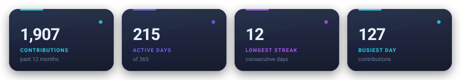
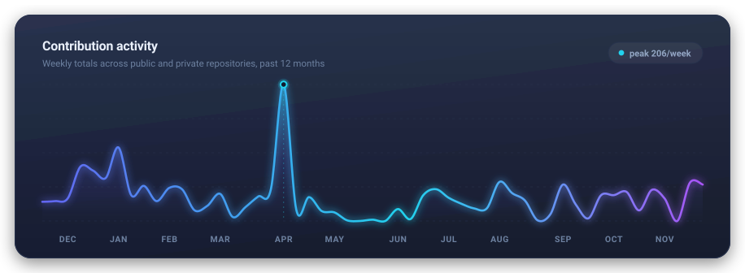

  

 

 

## What I work on

Enterprise field-operations apps, used by technicians on plant floors, refineries and remote sites — places where connectivity is optional and a dropped record is a lost work order. That one constraint shapes everything below.

**Offline-first sync** — incremental change feeds, an outbox for local writes, and conflict resolution that still holds up after days with no connection.

**Native data layer** — moving storage out of JavaScript into a C++/SQLite core, with thin Kotlin and Swift modules on either side of it.

**Background sync** — keeping a multi-gigabyte initial sync alive while the app is backgrounded or swiped away, on Android and iOS, which agree on none of the rules.

**React Native performance** — cold start, long-form rendering, and the real cost of crossing the bridge.

 

 

 

**Happy to talk about mobile architecture, offline sync, or why a React Native app takes nine seconds to start.**

karan.singare@innovapptive.com

